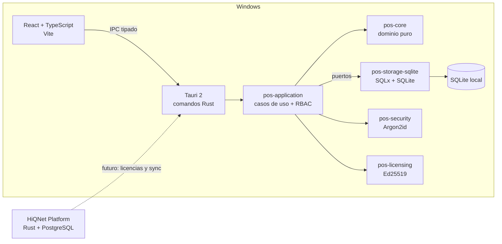

# Arquitectura de HiQNet POS

## Vista general



## Capas y reglas de dependencia

```text
pos-core  <-  pos-application  <-  pos-storage-sqlite
                    ^                    ^
                pos-security         apps/pos-desktop
                pos-licensing
```

- **`pos-core`**: entidades, value objects, invariantes y políticas puras. Sin
  SQLx, Tokio, Tauri ni configuration de infraestructura.
- **`pos-application`**: casos de uso, puertos de persistencia, autorización RBAC
  y contratos DTO. No conoce SQL ni nombres de tabla.
- **`pos-storage-sqlite`**: conexión, PRAGMAs, migraciones, transacciones y
  repositorios. No define reglas de negocio.
- **`pos-security`**: adaptador Argon2id del puerto `PasswordHasher`.
- **`pos-licensing`**: contrato de licencia firmada y verificación Ed25519.
  Nunca contiene clave privada.
- **`apps/pos-desktop`**: composición, ciclo de vida, estado de sesión y comandos
  IPC. No contiene reglas de catálogo, ventas ni autorización propia.

## Frontera de autorización

1. El comando IPC obtiene el `Actor` de la sesión en memoria de Rust.
2. El caso de uso exige el permiso RBAC (`Actor::require`).
3. El caso de uso exige el entitlement comercial cuando aplica.
4. El actor se usa para fijar `organization_id` y `branch_id`; nunca se aceptan
   del cliente.

La UI puede ocultar controles, pero una llamada IPC directa sin permiso falla.

## Transacciones

Toda mutación auditable usa una única `StoreTx`:

```text
BEGIN → validar → mutar → append audit → COMMIT
```

Si cualquier paso falla, la transacción se descarta (rollback de SQLx) y no queda
ni mutación ni evento. La tabla `audit_event` tiene triggers que abortan
`UPDATE` y `DELETE`.

El pool SQLite usa `max_connections = 1`, WAL, `foreign_keys = ON` y
`busy_timeout = 5s`. Esto serializa escrituras dentro del proceso y evita
bloqueos por concurrencia interna. La concurrencia entre dos instancias del POS
sobre el mismo archivo **no** está soportada todavía.

## Manejo de errores

- `DomainError`: invariantes y autorización.
- `AppError`: errores de aplicación con `code` estable para IPC.
- `IpcError` (desktop): serialización `{ code, message }` en español.
- El frontend normaliza el rechazo y nunca interpreta el mensaje para decidir.

## Datos

- La base real **nunca** vive en el repositorio.
- Ruta por defecto: Windows `%LOCALAPPDATA%\HiQNet\POS\data\hiqnet-pos.db`;
  Linux `$XDG_DATA_HOME/hiqnet-pos/data/hiqnet-pos.db`. La resolución vive en
  `pos-storage-sqlite::paths` y está cubierta por pruebas.
- Migraciones: `backend-rust/migrations/local/*.sql` (SQLx).
- Importes en centavos (`Money`) y cantidades en milésimas (`Quantity`).

## Fuera de alcance de esta fundación

Ventas, pagos, caja, inventario, compras, gastos, reportes, sincronización Pro,
billing y portal administrativo. Ver la matriz de funcionalidades.
