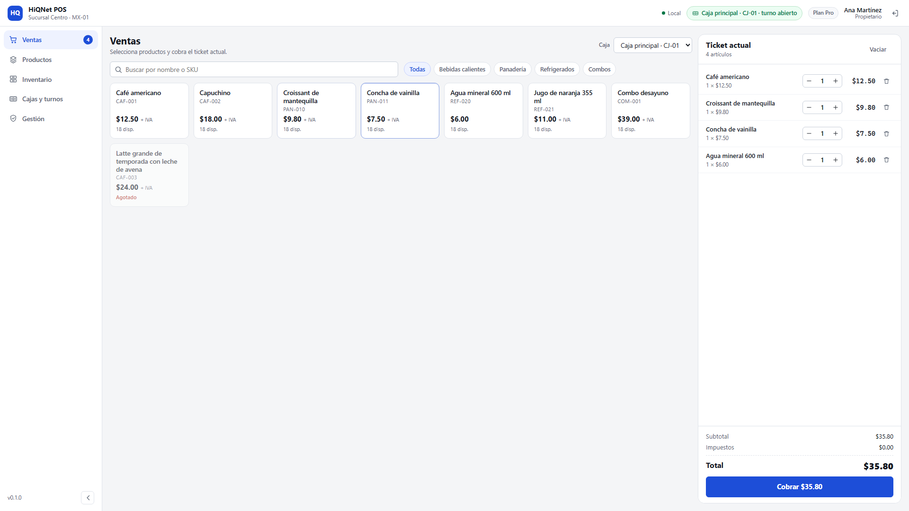
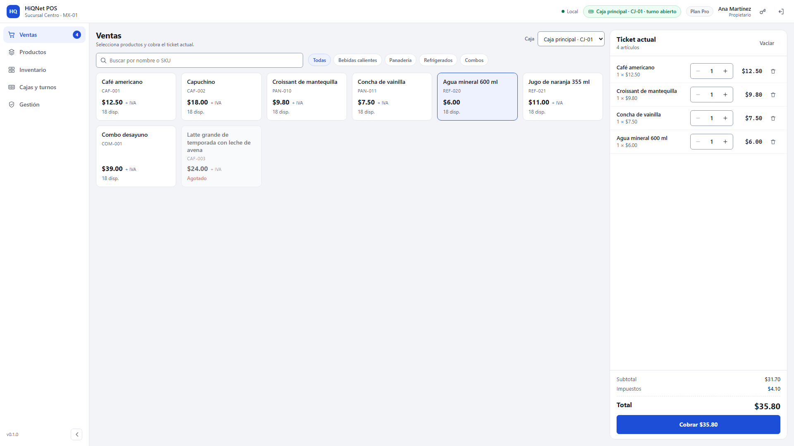
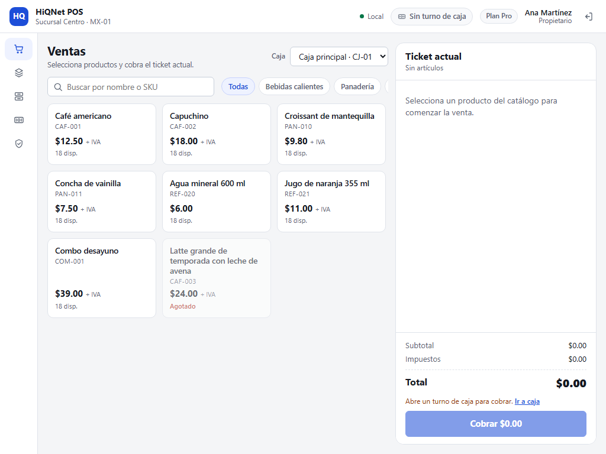
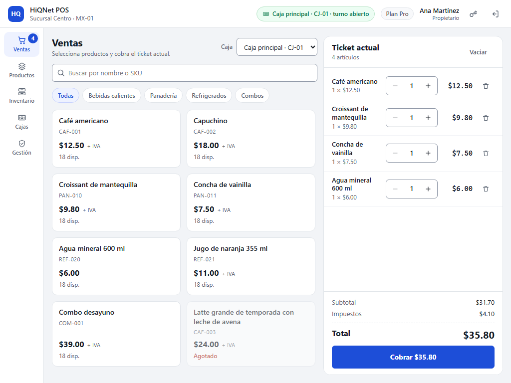
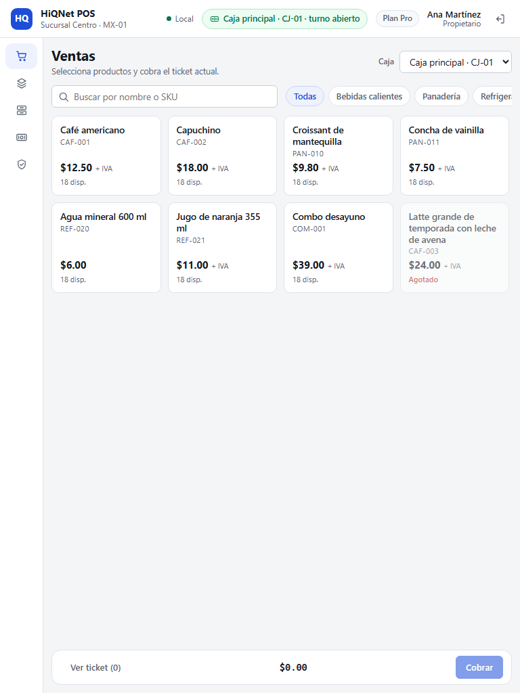
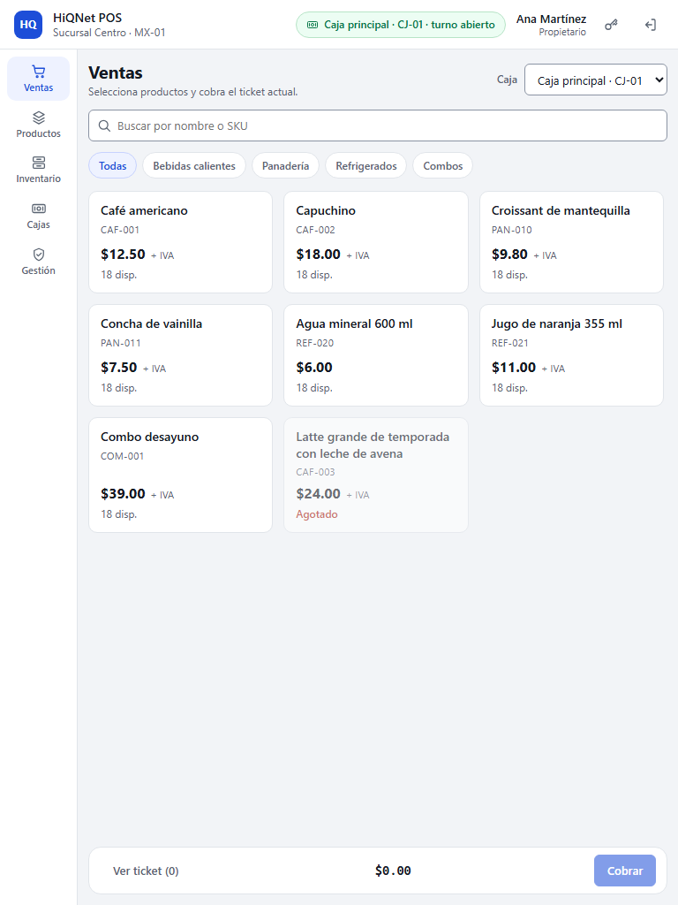
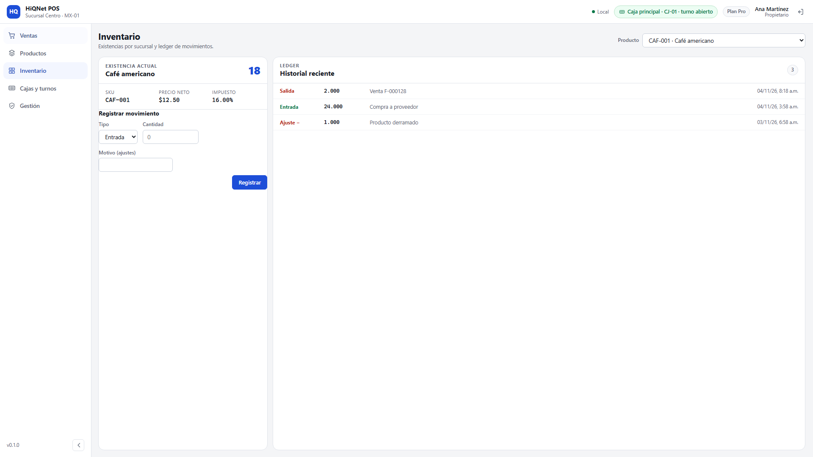
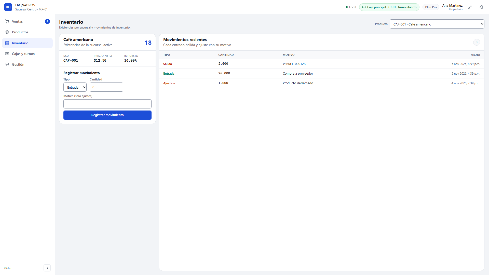

# Revisión de diseño — shell operativo de HiQNet POS

> Actualización 2026-11-05: esta revisión describe el estado del shell antes de
> la auditoría UX/UI de 0.1.0. Los cambios posteriores (navegación
> expandida/colapsada, prioridad de la barra superior, rejilla de reportes y
> centrado seguro de la autenticación) están en
> [`ux-audit-0.1.0.md`](ux-audit-0.1.0.md).

- Fecha: 2026-11-04
- Skill: Impeccable 4.8.0 (`npx impeccable install --project --no-hooks`)
- Alcance: `frontend/src` (shell, ventas, catálogo, inventario, caja y gestión)
- Modo de producto: **Operate** (aplicación de trabajo, no landing page)
- Ejecución: revisión en un solo contexto, sin subagentes disponibles. Se
  aplicaron los playbooks `init`, `document`, `critique`, `audit`, `shape`,
  `layout`, `distill`, `typeset`, `adapt`, `clarify`, `onboard`, `harden` y
  `polish` de la skill.

> Las capturas se generan con `frontend/e2e/visual.spec.ts` sobre un puente Tauri
> simulado. Verifican el render real del webview (composición, densidad,
> desbordes, contraste y foco), no el ejecutable empaquetado. El E2E nativo de
> Windows sigue siendo el de `tools/windows-native-e2e/`.

## 1. Auditoría inicial

Estado de partida: PR #11 con shell de escritorio y CI verde. La aplicación era
funcional, pero conservaba defectos de jerarquía, contraste, prevención de
errores y adaptación a tablet.

| # | Severidad | Hallazgo comprobable | Evidencia | Corrección |
| --- | --- | --- | --- | --- |
| 1 | P1 | El botón de cerrar sesión desaparecía a 1024×768 por compresión del `flex` de la barra superior. | `before/15-ventas-1024.png` | `flex: none` en los controles del extremo, nombre truncable y prueba de viewport. |
| 2 | P1 | Bordes de campos y anillo de foco por debajo de 3:1. | Tokens `#c8cfda` y `rgb(29 78 216 / 32%)` | `--color-control-border: #8a93a3` y `outline` sólido de 2 px; prueba de contraste y foco. |
| 3 | P1 | El cobro se podía confirmar con efectivo insuficiente; el error llegaba desde Rust. | `CheckoutDialog.tsx` | `canConfirm` exige importe válido y cambio ≥ 0; prueba nueva. |
| 4 | P1 | “Vaciar” borraba el ticket sin confirmación y el botón − quitaba la partida al llegar a 1. | `SalesScreen.tsx` | Confirmación modal y − deshabilitado en 1; pruebas nuevas. |
| 5 | P1 | En tablet la navegación quedaba solo con iconos, sin etiquetas visibles. | `before/16-tablet-catalogo.png` | Etiquetas cortas visibles y riel de 72 px por debajo de 1080 px; prueba de tablet. |
| 6 | P2 | 16 “eyebrows”/kickers sobre títulos, patrón prohibido por Impeccable. | `LoginScreen`, `CashScreen`, `InventoryScreen`, `AdminScreen`, `OnboardingScreen` | Eliminados; las etiquetas de sección pasan a texto normal o a encabezados reales. |
| 7 | P2 | Identificadores técnicos en la UI: `active`, `catalog`, `sale.completed`, “Ledger”. | `AdminScreen`, `InventoryScreen` | Mapas de traducción a español; “Movimientos recientes” y “Movimientos de inventario”. |
| 8 | P2 | Tarjetas de producto demasiado estrechas en 1920 y 768; chips de categoría cortados en 1366/768. | `before/04-ventas-ticket-1920.png`, `before/16-tablet-catalogo.png` | `minmax(175px, 1fr)`, chips con `flex-wrap` y tarjetas de 116 px. |
| 9 | P2 | Inventario: tabla sin encabezados, formulario pegado al borde y columna Fecha cortada a 1024. | `before/09-inventario-1920.png` | Tabla con `thead`, formulario con padding y tabla sin ancho mínimo. |
| 10 | P2 | Tras cerrar caja, el formulario “Abrir turno” quedaba por encima del resultado del arqueo. | `before/10-caja-1920.png` y captura de arqueo previa | El arqueo pasa a ser la vista principal y “Abrir nuevo turno” es una acción secundaria. |
| 11 | P2 | Degradado radial decorativo en autenticación y halo azul en el panel de apertura. | `styles.css` | Eliminados; profundidad por superficie y borde. |
| 12 | P2 | Escala tipográfica fragmentada: 20 tamaños distintos entre 10.5 y 26 px. | `styles.css` | Tokens `--text-xs…--text-2xl`; tamaños equivalentes consolidados. |
| 13 | P2 | En onboarding el botón principal se partía en dos líneas y el hint competía con la acción. | `before/02-onboarding-1366.png` | Botón de ancho completo y hint debajo; login con la misma regla. |
| 14 | P2 | Carga del catálogo como texto suelto, sin estructura. | `SalesScreen.tsx` | Esqueletos de tarjetas con `aria-busy`. |
| 15 | P2 | Historial de caja con importes sin etiqueta y nombre de caja truncado. | `before/10-caja-1920.png` | Etiquetas “Esperado” y “Contado”; nombre con salto de línea. |
| 16 | P3 | Concordancia “1 partidas en el ticket”. | `SideNav.tsx` | Singular/plural correcto. |
| 17 | P3 | 404 de `favicon.ico`. | Consola del navegador | `frontend/public/favicon.svg` enlazado desde `index.html`. |
| 18 | P3 | Duración “3 h 0 min”, fechas con formato distinto entre pantallas y sin enlace de salto. | `CashScreen`, `InventoryScreen`, `AppShell` | Duración abreviada, fecha media consistente y enlace “Saltar al contenido”. |

No se encontraron defectos P0: ninguna acción imprescindible quedaba bloqueada
en el estado inicial. Los P1 se corrigieron antes de considerar terminado el
rediseño.

## 2. Estructura implementada

```text
AppShell
├─ TopBar: identidad, sucursal, estado local, caja/turno, plan, usuario, salir
├─ SideNav: Ventas · Productos · Inventario · Caja · Gestión
└─ screen-host (una sola pantalla activa)
   ├─ SalesScreen: catálogo + ticket, configuración y cobro
   ├─ CatalogScreen: tabla + detalle de producto
   ├─ InventoryScreen: existencia, formulario y movimientos
   ├─ CashScreen: apertura, movimientos, arqueo e historial
   └─ AdminScreen: licencia, respaldos y auditoría
```

- El ticket vive en `AppShell`: navegar a inventario o caja no pierde la venta.
- La autorización sigue en Rust; `navigation.ts` solo decide qué se muestra.
- Ventas conserva el catálogo y el ticket simultáneos hasta 960 px; por debajo
  alterna vistas y mantiene una barra inferior con total y cobro.
- Las pantallas administrativas tienen scroll interno; no hay scroll global.

## 3. Sistema visual

Documentado en `DESIGN.md` (tokens + reglas). Resumen:

- Estrategia **Restrained**: neutros fríos + azul `#1d4ed8` para acción y
  selección.
- Una sola familia tipográfica (Segoe UI con respaldo), escala fija de 11 a
  24 px y números tabulares para importes.
- Profundidad por superficies y bordes de 1 px; sombras solo en paneles de
  autenticación y modales.
- Radios 6/10/14 px; chips y badges en píldora.
- Estados de éxito, advertencia, error, carga, vacío, foco y deshabilitado
  definidos en el mismo vocabulario para todas las pantallas.

## 4. Detector

| Ejecución | Comando | Resultado |
| --- | --- | --- |
| Código, antes | `impeccable detect --json frontend/src` | `[]` |
| Código, después | `impeccable detect --json frontend/src` | `[]` |
| Render inicial | `impeccable detect http://127.0.0.1:4173 --json` | `[]` |

El detector no marca estos hallazgos porque son de jerarquía, copy, contraste
calculado y comportamiento; por eso la revisión visual renderizada es la
evidencia principal. No se desactivó ninguna regla.

## 5. Verificación visual

Harness: `frontend/e2e/visual.spec.ts` (`VISUAL_REVIEW=1`). Puente Tauri
simulado con productos, variantes, modificadores, turno abierto, movimientos,
auditoría y venta confirmada. Animaciones desactivadas con
`prefers-reduced-motion` para capturas estables.

| Resolución | Pantallas verificadas |
| --- | --- |
| 1920×1080 | Login, ventas vacío, ticket, configurador, checkout, venta confirmada, inventario, caja, arqueo, gestión, productos |
| 1440×900 | Ventas con ticket |
| 1366×768 | Ventas con ticket |
| 1024×768 | Ventas, caja, inventario |
| 768×1024 | Ventas catálogo, ticket, caja, inventario, productos |

Comprobaciones automatizadas:

- `document.scrollWidth ≤ clientWidth` en todas las capturas.
- “Cobrar” dentro del viewport a 1366×768.
- “Cerrar sesión” dentro del viewport a 1366 y 1024.
- Etiquetas de navegación y chips de categoría visibles en tablet.
- Contraste ≥ 4.5:1 en etiquetas, SKU, disponibilidad, subtítulo y botón
  primario; borde de campo ≥ 3:1; foco con `outline` ≥ 2 px.
- Sin errores de consola (favicon incluido).

### Comparación clave

Ventas en 1920×1080, antes y después:





Ventas en 1024×768, donde se perdía el cierre de sesión:





Tablet 768×1024, navegación con etiquetas y todas las categorías visibles:





Inventario con tabla legible y formulario contenido:





El resto de capturas (checkout, venta confirmada, caja, arqueo, productos,
gestión, tablet de caja e inventario) está en
`docs/04-quality/design-review/after/`.

## 6. Pruebas funcionales

| Comprobación | Resultado |
| --- | --- |
| `pnpm lint` | Pasa |
| `pnpm typecheck` | Pasa |
| `pnpm test` | 40 pruebas, 5 archivos |
| `pnpm build` | Pasa |
| `VISUAL_REVIEW=1 playwright test e2e/visual.spec.ts` | 4 pruebas, 4 pasan |
| E2E nativo Windows | No re-ejecutado en esta sesión; se conserva `tools/windows-native-e2e/` |

Pruebas añadidas: decremento bloqueado en 1, confirmación al vaciar, cobro
bloqueado con efectivo insuficiente, etiquetas de viewport, contraste y foco.

## 7. Limitaciones

- El E2E nativo de Windows no se ejecutó aquí; las capturas son del webview con
  IPC simulado. La validación sobre el ejecutable sigue siendo
  `tools/windows-native-e2e/run-e2e.ps1`.
- No hay modo oscuro.
- Pantallas con pocos registros conservan espacio vertical vacío; es el estado
  real, no contenido inventado.
- El historial de auditoría sigue siendo una lista, no una tabla con columnas.
- Fuera de alcance funcional: otros medios de pago, devoluciones, CFDI,
  inventario por variante y sincronización cloud.
